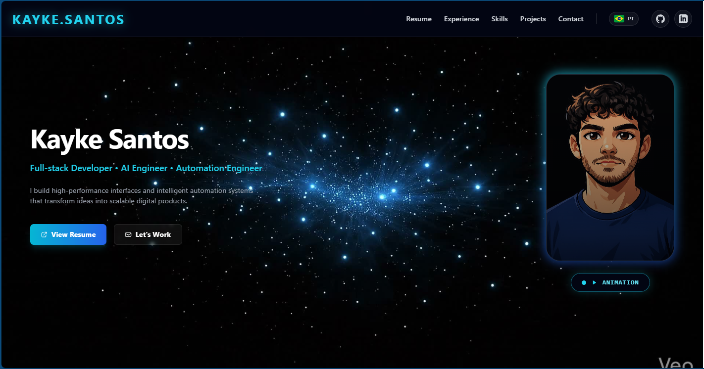
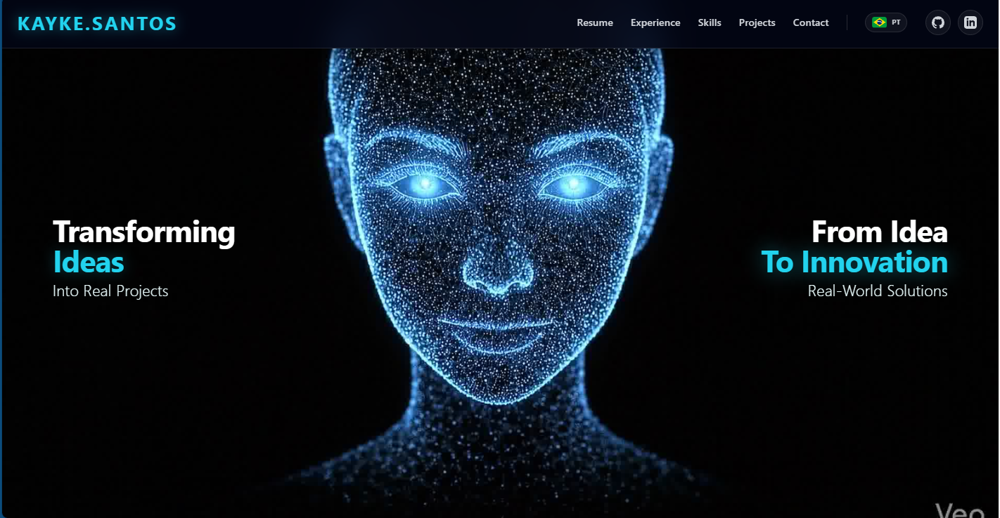
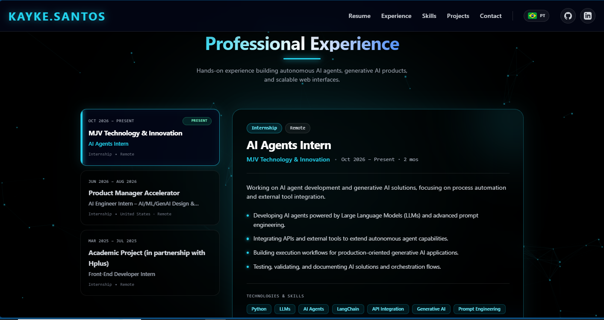
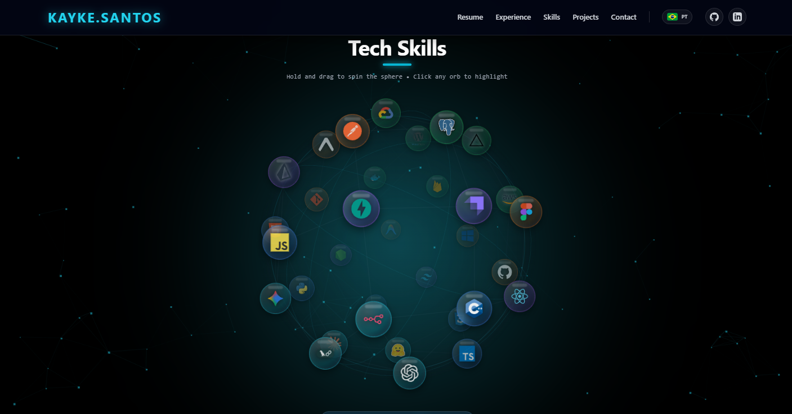
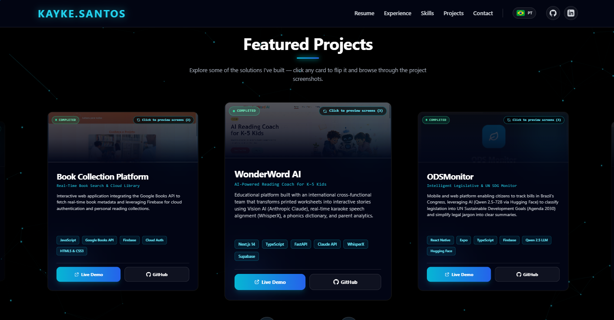

# Kayke Santos — Interactive Developer & AI Engineer Portfolio

A modern, interactive personal portfolio web application built to showcase my software engineering journey, professional experience in AI & Full-Stack development, interactive 3D skills visualization, featured projects, certifications, and bilingual resume.

---

## Preview

### Hero Section & Auto-Play Animation


### Interactive Canvas Scrollytelling Sequence


### Professional Experience Dossier


### Interactive 3D Skills Sphere


### Featured Projects (3D Flip Cards)


---

## Tech Stack

| Layer | Technologies |
| :--- | :--- |
| **Core Framework** | React 19, JavaScript (ES6+), Vite 7 (`@vitejs/plugin-react-swc`) |
| **Styling** | Tailwind CSS 3, PostCSS, Autoprefixer, Custom Design Tokens |
| **Animations & 3D** | Framer Motion 12, HTML5 `<canvas>` (2D & Custom 3D Projection Math) |
| **Routing & State** | React Router DOM 7, React Context API (`LanguageContext`, `ScrollContext`) |
| **Contact & Deploy** | Web3Forms API, Vercel |
| **Code Quality** | ESLint 9 (`@eslint/js`, `eslint-plugin-react-hooks`, `eslint-plugin-react-refresh`) |

---

## Key Features

- **Interactive Canvas Scrollytelling Hero & Auto-Play `Animation`:**
  - Synchronizes a 168-frame visual sequence on a full-viewport `<canvas>` with scroll progress and cinematic hero messages.
  - Includes a dedicated **Animation** button below the hero avatar that smoothly auto-scrolls through all frames and rests on the final frame (immediately yielding control if the user scrolls manually).
  - **Instant Header Navigation Bypass:** Clicking any section link in the header (*Experience*, *Skills*, *Projects*, *Contact*) disables the hero scroll animation immediately and jumps straight to the target section — even when navigating from `/curriculo`.
- **Interactive 3D Skills Sphere (`33` Technologies):**
  - Distributes 33 skills across a 3D Fibonacci sphere rendered with custom gimbal-lock-free `3×3` orthogonal rotation matrices, perspective depth scaling, rotating wireframe meridians, and holographic node connections.
  - Supports **360° hold-and-drag rotation** (mouse & touch) with inertia, **click-to-highlight** (smoothly rotates the selected orb to front-center with a glowing HUD spotlight panel), and clickable category filters.
- **Professional Experience Section:**
  - Master-detail interactive tab layout highlighting roles at **MJV Technology & Innovation** (*AI Agents Intern*), **Product Manager Accelerator** (*AI Engineer Intern — WonderWord AI, Tier 1 Awardee*), and **Hplus** (*Front-End Developer Intern*).
- **3D Flip-Card Projects Showcase:**
  - Smooth spring-physics carousel with interactive **180° 3D flip cards** revealing real project screenshots, multi-image navigation controls, and a full-screen lightbox viewer.
  - Showcases **WonderWord AI**, **ODSMonitor**, **SmartWeather**, **SmartMail-n8n-AI**, **Singularity 3D Universe**, **Personal Portfolio**, and **Book Collection Platform**.
- **Expandable Certifications Grid:**
  - Filterable, paginated 3D flip cards featuring **PM Accelerator Certified AI Engineer**, **Google AI Professional Certificate**, **Google Data Analytics Professional Certificate**, and Alura credentials with direct verification links.
- **Bilingual Support (`EN` / `PT-BR`) & Vector Flags:**
  - Instant language switching across the entire UI using crisp inline SVG flags (Brazil & USA) in the header.
- **Full-Width Resume Viewer (`/curriculo`):**
  - Dynamically loads the English (`US Letter`) or Portuguese (`A4`) PDF matched to each document's exact aspect ratio, opens pre-fitted to full panel width (`#view=FitH`), preserves native zoom controls (`+`/`-`), and provides one-click download.

---

## Project Organization & Directory Structure

```text
Portfolio/
├── public/
│   └── assets/
│       ├── documents/               # Bilingual PDF resumes (PT A4 & EN US Letter)
│       ├── port/                    # Portfolio UI showcase screenshots
│       ├── projects/                # Project screenshots (WonderWord, ODSMonitor, SmartWeather, n8n, 3D Universe, etc.)
│       ├── icone.jpg                # Hero avatar illustration
│       └── kayke.jpeg               # About Me portrait photo
├── src/
│   ├── assets/
│   │   └── videos/
│   │       ├── certificates/        # Bundled certificate images (PM Accelerator, Google AI, Google Data Analytics, Alura)
│   │       ├── frames/              # 168 sequential JPG frames for the Hero canvas animation
│   │       └── loading.mp4          # Initial loading screen video overlay
│   ├── components/
│   │   ├── About.jsx                # About Me section with portrait frame and focus tags
│   │   ├── BackgroundParticles.jsx  # Ambient canvas particles active below the Hero
│   │   ├── Certificates.jsx         # Expandable, filterable 3D flip-card certifications grid
│   │   ├── Contact.jsx              # Contact form integrated with Web3Forms API
│   │   ├── Experience.jsx           # Interactive master-detail professional experience dossier
│   │   ├── Footer.jsx               # Footer with social links and click-to-copy email/phone
│   │   ├── frames.jsx               # 168-frame canvas scrollytelling controller with instant nav bypass
│   │   ├── HeroMessages.jsx         # Timed kinetic typography overlays during the Hero sequence
│   │   ├── HeroOverlay.jsx          # Hero intro, CTA buttons, floating avatar, and Auto-Play Animation trigger
│   │   ├── Journey.jsx              # Vertical scroll-linked timeline of learning milestones
│   │   ├── loading.jsx              # Initial fullscreen loading overlay
│   │   ├── navbar.jsx               # Responsive glassmorphic header with SVG flags & instant section jumps
│   │   ├── Projects.jsx             # Spring carousel with 3D flip cards, multi-image viewer & lightbox
│   │   ├── Skills.jsx               # 60fps 3D Fibonacci skills sphere with trackball drag & HUD spotlight
│   │   └── TechParticles.jsx        # Interactive mouse-reactive particle network (used on /curriculo)
│   ├── context/
│   │   ├── LanguageContext.jsx      # Global PT/EN language state provider
│   │   └── ScrollContext.jsx        # Shared scroll position state for Hero visibility hooks
│   ├── hooks/
│   │   ├── useLoading.js            # Initial overlay timer hook
│   │   ├── useScrollHide.js         # Threshold-based element hide hook
│   │   ├── useScrollShow.js         # Threshold-based element reveal hook
│   │   ├── useTechParticles.js      # Canvas particle physics engine hook
│   │   └── useWindowSize.js         # Responsive viewport dimensions hook
│   ├── pages/
│   │   ├── home.jsx                 # Main landing page with React.lazy + Suspense below-the-fold sections
│   │   └── curriculo.jsx            # Dedicated A4/Letter PDF resume viewer and download page
│   ├── utils/
│   │   ├── scrollToSection.js       # Instant section jump (animation bypass) and Hero auto-play controller
│   │   └── translations.js          # Centralized PT/EN internationalization dictionary
│   ├── App.jsx                      # Global providers (Language, Scroll) and React Router routes
│   ├── index.css                    # Design tokens, base theme styles, and keyframe animations
│   └── main.jsx                     # React application entry point
├── eslint.config.js                 # ESLint 9 flat configuration
├── index.html                       # HTML entry template
├── package.json                     # Dependencies and npm scripts
├── tailwind.config.js               # Tailwind config with semantic z-index layering tokens
└── vite.config.js                   # Vite + React SWC build configuration
```

---

## Architecture & Performance Highlights

1. **Progressive Batched Frame Loading (`frames.jsx`):**
   - Immediately loads and renders **Frame 0** on mount to eliminate blank screens, then streams the remaining 167 frames in non-blocking batches of 20 in the background while the initial loading overlay plays.
2. **Code Splitting Below the Fold (`home.jsx`):**
   - Secondary sections (`About`, `Journey`, `Experience`, `Skills`, `Projects`, `Certificates`, `Contact`, `Footer`) are dynamically imported with `React.lazy` and wrapped in `<Suspense>`, keeping initial bundle parsing fast.
3. **Zero-Reconciliation 60fps 3D Sphere (`Skills.jsx`):**
   - The 3D sphere updates orb positions, depth-sorted `z-index`, perspective scale, and wireframe canvas lines inside a single `requestAnimationFrame` loop using direct DOM refs, avoiding React re-renders during drag interactions.
4. **Crisp Font Rendering on 3D Flip Cards (`Projects.jsx`):**
   - 3D CSS layers (`perspective` and `transform-style: preserve-3d`) are activated only while a project card is flipping or flipped, preserving native 2D subpixel text clarity on hover.
5. **Semantic Z-Index Layering (`tailwind.config.js`):**
   - All overlapping layers follow explicit tokens (`background: 0`, `content: 10`, `overlay: 30`, `hero: 40`, `nav: 50`, `hud: 60`) to prevent stacking conflicts across modals, particles, and fixed overlays.
